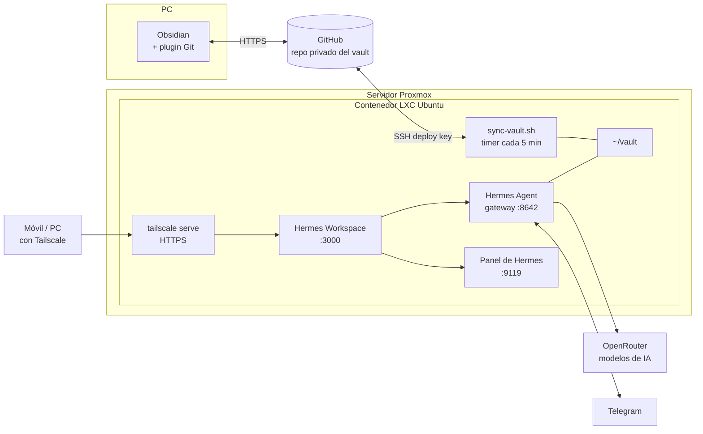

# Hermes Agent en Proxmox con Obsidian, GitHub y Tailscale

🌐 [English](README.md) · **Español**


Documentación completa de un asistente de IA autoalojado: **Hermes Agent** (Nous Research) corriendo en un contenedor LXC de Proxmox, con acceso a un vault de **Obsidian** sincronizado por **GitHub**, modelos de IA a través de **OpenRouter**, acceso remoto privado con **Tailscale** y una interfaz web instalable en el móvil con **Hermes Workspace**.

La guía está escrita paso a paso, en el orden real en que se montó todo, e incluye **todos los errores que aparecieron durante la instalación**, con su causa y su solución.

## Qué hace este proyecto

- Hermes vive 24/7 en un contenedor dentro de un servidor Proxmox casero.
- Hermes lee, busca y escribe notas en el vault de Obsidian.
- El vault se sincroniza automáticamente entre el PC, GitHub y el contenedor cada 5 minutos, con historial completo de cada cambio.
- Se puede hablar con Hermes desde una interfaz web (también instalable como app en el móvil) y desde Telegram.
- Todo el acceso remoto pasa por una red privada de Tailscale: no hay ningún puerto abierto a internet.

## Arquitectura



GitHub no envía nada por sí mismo: cada lado (PC y contenedor) descarga y sube sus cambios cada 5 minutos. Por eso el PC no necesita estar encendido cuando Hermes trabaja.

## Componentes

| Componente | Función | Costo |
| --- | --- | --- |
| Proxmox VE | Hipervisor que aloja el contenedor | Gratis |
| LXC Ubuntu 24.04 | Contenedor donde viven Hermes y sus servicios | Gratis |
| Hermes Agent | Agente de IA con memoria, skills, terminal y automatizaciones | Gratis (MIT) |
| OpenRouter | Acceso a los modelos de IA por API | Pago por uso (hay modelos gratuitos) |
| Obsidian + plugin Obsidian Git | Notas en Markdown y sincronización desde el PC | Gratis (uso personal) |
| GitHub (repo privado) | Punto central de sincronización e historial del vault | Gratis |
| Tailscale | VPN privada para acceder desde cualquier lugar | Gratis (plan personal) |
| Hermes Workspace | Interfaz web para Hermes, instalable como app | Gratis (MIT) |
| Telegram | Canal de mensajes y notificaciones con Hermes | Gratis |

## Guías

Sigue las guías en orden. Cada una termina con una comprobación para confirmar que esa parte funciona antes de pasar a la siguiente.

| # | Guía | Dónde se hace | Resultado |
| --- | --- | --- | --- |
| 1 | [Preparar el contenedor LXC](docs/es/01-preparar-lxc.md) | Proxmox y LXC | Usuario `hermes` con sudo y herramientas básicas |
| 2 | [Vault de Obsidian y GitHub](docs/es/02-vault-y-github.md) | PC y GitHub | Vault subido a un repo privado y plugin sincronizando |
| 3 | [Sincronización en el LXC](docs/es/03-sincronizacion-lxc.md) | LXC y GitHub | Copia del vault en el contenedor, sincronizada cada 5 minutos |
| 4 | [Conectar Hermes al vault](docs/es/04-hermes-y-obsidian.md) | LXC | Hermes instalado, con OpenRouter, leyendo y escribiendo notas |
| 5 | [Tailscale en el LXC](docs/es/05-tailscale.md) | Proxmox, LXC y panel de Tailscale | El contenedor forma parte de la red privada |
| 6 | [Hermes Workspace](docs/es/06-hermes-workspace.md) | LXC y dispositivos | Interfaz web con HTTPS e instalable en el móvil |
| 7 | [Solución de problemas](docs/es/07-solucion-de-problemas.md) | — | Todos los errores encontrados y cómo se resolvieron |
| 8 | [Decisiones de diseño](docs/es/08-decisiones-de-diseno.md) | — | Por qué se eligió cada pieza frente a sus alternativas |
| 9 | [Mantenimiento](docs/es/09-mantenimiento.md) | — | Actualizaciones, revisiones, rotación de claves y copias de seguridad |

## Servicios y puertos

Todos los servicios escuchan solo en `127.0.0.1` dentro del contenedor. Lo único accesible desde fuera es la interfaz, publicada por Tailscale con HTTPS y visible solo para los dispositivos de la propia red de Tailscale.

| Servicio | Puerto | Cómo arranca |
| --- | --- | --- |
| Gateway de Hermes (API y Telegram) | `127.0.0.1:8642` | Servicio systemd de usuario |
| Panel de Hermes | `127.0.0.1:9119` | Servicio systemd de usuario |
| Hermes Workspace | `127.0.0.1:3000` | Servicio systemd de usuario |
| Sincronización del vault | — | Timer systemd de usuario, cada 5 minutos |
| Tailscale Serve | HTTPS 443 en la red de Tailscale | Persistente tras reinicios |

## Estructura del repositorio

```
.
├── README.md                Versión en inglés
├── README.es.md             Versión en español
├── docs/
│   ├── en/                  Guías en inglés
│   └── es/                  Guías en español
├── scripts/
│   └── sync-vault.sh        Script de sincronización del vault
├── systemd/                 Unidades systemd de usuario
│   ├── vault-sync.service
│   ├── vault-sync.timer
│   ├── hermes-dashboard.service
│   └── hermes-workspace.service.d/override.conf
└── config/                  Plantillas de configuración con valores de ejemplo
    ├── vault.gitignore.example
    ├── ssh_config.example
    ├── hermes.env.example
    ├── workspace.env.example
    └── lxc-tun.conf.example
```

## Marcadores usados en la guía

La documentación no incluye datos personales. Donde haya que poner un valor propio, se usan estos marcadores. Las plantillas de `config/` son compartidas por ambos idiomas y usan el nombre en inglés:

| Marcador en las guías | En las plantillas | Qué representa |
| --- | --- | --- |
| `<usuario-github>` | `<github-user>` | Tu usuario de GitHub |
| `<repo-vault>` | `<vault-repo>` | El repositorio privado donde se guarda el vault |
| `<nombre-vault>` | `<vault-name>` | El nombre de la carpeta del vault de Obsidian |
| `<clave-generada>` | `<generated-key>` | La clave del API de Hermes |
| `<contraseña-de-la-interfaz>` | `<interface-password>` | La contraseña de Hermes Workspace |
| `<ID>` | `<ID>` | El número del contenedor en Proxmox (por ejemplo, `101`) |
| `<tu-tailnet>` | `<your-tailnet>` | El nombre de tu red de Tailscale |
| `hermesagent` | `hermesagent` | Nombre del contenedor usado en los ejemplos |
| `hermes` | `hermes` | Usuario de Linux dentro del contenedor |

## Lecciones aprendidas

- **Los nombres de ejemplo provocan la mitad de los errores.** Dos fallos de "Repository not found" vinieron de dejar `TU-USUARIO/obsidian-vault` en un comando. El mensaje de `ssh -T` con la deploy key indica el usuario y el repo exactos.
- **La consola noVNC de Proxmox corrompe el texto copiado.** La consola xterm.js evita llaves SSH cortadas y comandos rotos.
- **Pegar bloques con `EOF` en una sola línea no funciona.** Crear los archivos con `nano` es más fiable.
- **Un `.gitignore` en la raíz no se aplica a subcarpetas** salvo que los patrones empiecen por `**/`.
- **Un servicio systemd no lee un `.env` por sí solo.** Hay que indicarlo con `EnvironmentFile`; si no, la interfaz arranca sin contraseña y sin la clave del API.
- **Cada máquina de Tailscale es independiente.** `tailscale serve` publica servicios de la máquina donde se ejecuta, así que Tailscale tiene que estar dentro del contenedor.
- **Una clave compartida es una clave comprometida.** Si una clave aparece en un chat o una captura, se sustituye.

## Seguridad

- El repositorio del vault es **privado** y el contenedor accede a él con una **deploy key** limitada a ese único repositorio.
- Hermes tiene acceso a la terminal del contenedor: la clave `API_SERVER_KEY` equivale a control total y nunca debe publicarse.
- Ningún puerto se abre en el router. El acceso remoto pasa por Tailscale.
- La interfaz está protegida con contraseña y servida por HTTPS.

## Proyectos utilizados

- [Hermes Agent](https://github.com/NousResearch/hermes-agent) de Nous Research
- [Hermes Workspace](https://github.com/outsourc-e/hermes-workspace)
- [Obsidian Git](https://github.com/Vinzent03/obsidian-git)
- [Tailscale](https://tailscale.com)
- [OpenRouter](https://openrouter.ai)
- [Proxmox VE](https://www.proxmox.com)

> Hermes Agent y Hermes Workspace se actualizan con mucha frecuencia. Si algún menú o comando no coincide con esta guía, revisa la documentación oficial de cada proyecto.
