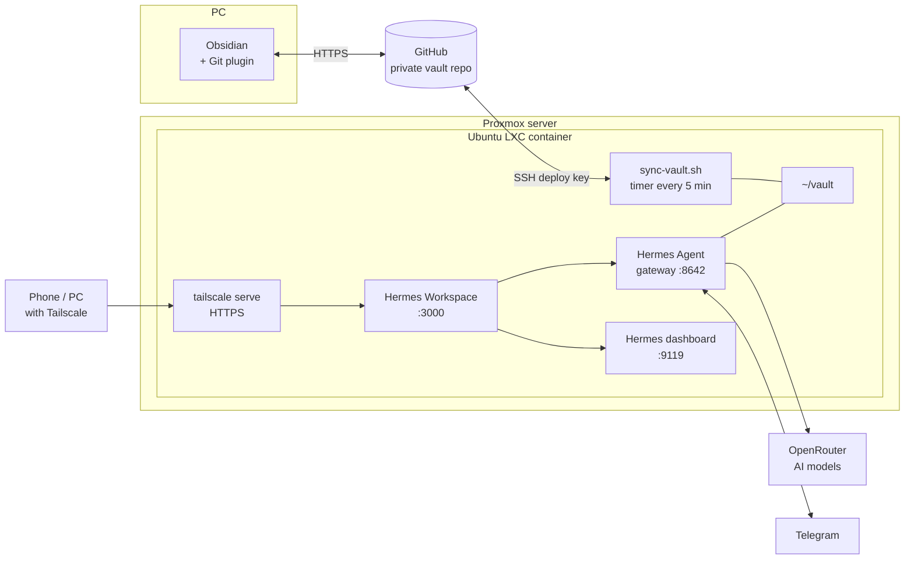

# Hermes Agent on Proxmox with Obsidian, GitHub and Tailscale

🌐 **English** · [Español](README.es.md)


Complete documentation of a self-hosted AI assistant: **Hermes Agent** (by Nous Research) running in a Proxmox LXC container, with access to an **Obsidian** vault synced through **GitHub**, AI models through **OpenRouter**, private remote access with **Tailscale**, and a web interface that installs as an app on a phone with **Hermes Workspace**.

The guide is written step by step, in the actual order the system was built, and includes **every error that came up during the installation**, along with its cause and fix.

## What this project does

- Hermes runs 24/7 in a container on a home Proxmox server.
- Hermes reads, searches and writes notes in the Obsidian vault.
- The vault syncs automatically between the PC, GitHub and the container every 5 minutes, with a full history of every change.
- You can talk to Hermes from a web interface (also installable as a phone app) and from Telegram.
- All remote access goes through a private Tailscale network: no port is open to the internet.

## Architecture



GitHub doesn't push anything on its own: each side (PC and container) pulls and pushes its changes every 5 minutes. That's why the PC doesn't need to be on while Hermes is working.

## Components

| Component | Role | Cost |
| --- | --- | --- |
| Proxmox VE | Hypervisor that hosts the container | Free |
| Ubuntu 24.04 LXC | Container where Hermes and its services live | Free |
| Hermes Agent | AI agent with memory, skills, terminal access and automations | Free (MIT) |
| OpenRouter | API access to AI models | Pay per use (free models available) |
| Obsidian + Obsidian Git plugin | Markdown notes and sync from the PC | Free (personal use) |
| GitHub (private repo) | Central sync point and vault history | Free |
| Tailscale | Private VPN for access from anywhere | Free (personal plan) |
| Hermes Workspace | Web interface for Hermes, installable as an app | Free (MIT) |
| Telegram | Messaging and notification channel with Hermes | Free |

## Guides

Follow the guides in order. Each one ends with a check to confirm that part works before moving on.

| # | Guide | Where | Result |
| --- | --- | --- | --- |
| 1 | [Prepare the LXC container](docs/en/01-prepare-lxc.md) | Proxmox and LXC | `hermes` user with sudo and basic tools |
| 2 | [Obsidian vault and GitHub](docs/en/02-vault-and-github.md) | PC and GitHub | Vault pushed to a private repo and plugin syncing |
| 3 | [Sync in the LXC](docs/en/03-lxc-sync.md) | LXC and GitHub | Copy of the vault in the container, synced every 5 minutes |
| 4 | [Connect Hermes to the vault](docs/en/04-hermes-and-obsidian.md) | LXC | Hermes installed with OpenRouter, reading and writing notes |
| 5 | [Tailscale in the LXC](docs/en/05-tailscale.md) | Proxmox, LXC and Tailscale admin console | The container joins the private network |
| 6 | [Hermes Workspace](docs/en/06-hermes-workspace.md) | LXC and devices | HTTPS web interface, installable on a phone |
| 7 | [Troubleshooting](docs/en/07-troubleshooting.md) | — | Every error found and how it was solved |
| 8 | [Design decisions](docs/en/08-design-decisions.md) | — | Why each piece was chosen over its alternatives |
| 9 | [Maintenance](docs/en/09-maintenance.md) | — | Updates, health checks, key rotation and backups |

## Services and ports

Every service listens only on `127.0.0.1` inside the container. The only thing reachable from outside is the interface, published by Tailscale over HTTPS and visible only to devices on your own Tailscale network.

| Service | Port | How it starts |
| --- | --- | --- |
| Hermes gateway (API and Telegram) | `127.0.0.1:8642` | systemd user service |
| Hermes dashboard | `127.0.0.1:9119` | systemd user service |
| Hermes Workspace | `127.0.0.1:3000` | systemd user service |
| Vault sync | — | systemd user timer, every 5 minutes |
| Tailscale Serve | HTTPS 443 on the Tailscale network | Persists across reboots |

## Repository structure

```
.
├── README.md                English version
├── README.es.md             Spanish version
├── docs/
│   ├── en/                  Guides in English
│   └── es/                  Guides in Spanish
├── scripts/
│   └── sync-vault.sh        Vault sync script
├── systemd/                 systemd user units
│   ├── vault-sync.service
│   ├── vault-sync.timer
│   ├── hermes-dashboard.service
│   └── hermes-workspace.service.d/override.conf
└── config/                  Configuration templates with example values
    ├── vault.gitignore.example
    ├── ssh_config.example
    ├── hermes.env.example
    ├── workspace.env.example
    └── lxc-tun.conf.example
```

## Placeholders used in the guide

The documentation contains no personal data. Wherever you need to put your own value, these placeholders are used:

| Placeholder | What it stands for |
| --- | --- |
| `<github-user>` | Your GitHub username |
| `<vault-repo>` | The private repository that stores the vault |
| `<vault-name>` | The name of the Obsidian vault folder |
| `<generated-key>` | The Hermes API key |
| `<interface-password>` | The Hermes Workspace password |
| `<ID>` | The container number in Proxmox (for example, `101`) |
| `<your-tailnet>` | The name of your Tailscale network |
| `hermesagent` | Container name used in the examples |
| `hermes` | Linux user inside the container |

## Lessons learned

- **Placeholder names cause half the errors.** Two "Repository not found" failures came from leaving `TU-USUARIO/obsidian-vault` in a command. The `ssh -T` greeting from the deploy key shows the exact user and repo.
- **The Proxmox noVNC console corrupts copied text.** The xterm.js console avoids truncated SSH keys and broken commands.
- **Pasting `EOF` blocks on a single line doesn't work.** Creating files with `nano` is more reliable.
- **A `.gitignore` in the repo root doesn't apply to subfolders** unless the patterns start with `**/`.
- **A systemd service doesn't read a `.env` file by itself.** It has to be declared with `EnvironmentFile`; otherwise the interface starts without a password and without the API key.
- **Each Tailscale machine is independent.** `tailscale serve` publishes services on the machine where it runs, so Tailscale has to live inside the container.
- **A shared key is a compromised key.** If a key shows up in a chat or a screenshot, replace it.

## Security

- The vault repository is **private**, and the container accesses it with a **deploy key** limited to that single repository.
- Hermes has terminal access inside the container: `API_SERVER_KEY` is equivalent to full control and must never be published.
- No port is opened on the router. Remote access goes through Tailscale.
- The interface is password-protected and served over HTTPS.

## Projects used

- [Hermes Agent](https://github.com/NousResearch/hermes-agent) by Nous Research
- [Hermes Workspace](https://github.com/outsourc-e/hermes-workspace)
- [Obsidian Git](https://github.com/Vinzent03/obsidian-git)
- [Tailscale](https://tailscale.com)
- [OpenRouter](https://openrouter.ai)
- [Proxmox VE](https://www.proxmox.com)

> Hermes Agent and Hermes Workspace are updated very frequently. If a menu or command doesn't match this guide, check each project's official documentation.
