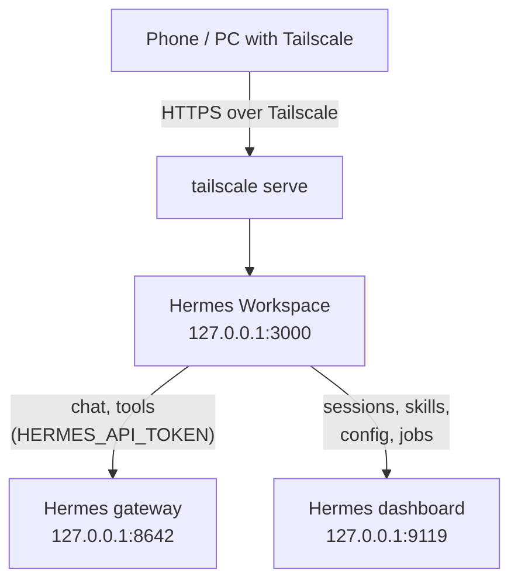

# 6. Hermes Workspace

🌐 **English** · [Español](../es/06-hermes-workspace.md)

[← Previous: Tailscale in the LXC](05-tailscale.md) · [Index](../../README.md) · [Next: Troubleshooting →](07-troubleshooting.md)

Hermes Workspace is a web interface for Hermes Agent: chat with tool-call rendering, memory and skills browser, scheduled tasks, MCP servers, files, terminal and a cost dashboard. It installs as an app (PWA) on phones and PCs. Workspace is only the interface; **Hermes still does all the work**.

## How the pieces fit



All three services listen only on `127.0.0.1`: nothing on the local network can reach them directly. Tailscale publishes only the interface, over HTTPS, to devices on your private network.

Everything happens in the container's xterm.js console, as `hermes`.

## 6.1 Check resources

Building Workspace takes a fair amount of memory: the container needs at least **4 GB of RAM** and **1 GB of swap** (Proxmox → container → **Resources**).

```bash
df -h /
```

**Avail** should show at least 5 GB free.

## 6.2 Update Hermes

Workspace needs Hermes's recent APIs; with an old version only basic chat works.

```bash
hermes update
```

## 6.3 Enable the Hermes API

Generate a secret key and keep it somewhere safe:

```bash
openssl rand -hex 32
```

```bash
nano ~/.hermes/.env
```

Make sure these lines exist **exactly once** (if they're already there, edit them instead of adding duplicates):

```
API_SERVER_ENABLED=true
API_SERVER_HOST=127.0.0.1
API_SERVER_PORT=8642
API_SERVER_KEY=<generated-key>
```

| Variable | Purpose |
| --- | --- |
| `API_SERVER_ENABLED` | Turns on the OpenAI-compatible API on port 8642 |
| `API_SERVER_HOST=127.0.0.1` | Reachable only from inside the container |
| `API_SERVER_PORT` | API port (8642 is the default) |
| `API_SERVER_KEY` | Key the API requires. Grants full control over Hermes, terminal included |

Don't delete the rest of the file (OpenRouter API key, `OBSIDIAN_VAULT_PATH`, Telegram). Template: [`config/hermes.env.example`](../../config/hermes.env.example).

> In this installation these lines already existed with `API_SERVER_HOST=0.0.0.0`, left over from an earlier test with another interface (Odysseus) running in Docker. With Workspace in the same container, `127.0.0.1` is enough and safer. On top of that, the key had been shared in a chat, so it was replaced (see [E19](07-troubleshooting.md#e19-api_server_host0000-and-a-shared-key)).

## 6.4 Gateway as a service

```bash
hermes gateway install
```

If it was already installed, restart it so it picks up the changes. Find the service name:

```bash
systemctl --user list-units | grep -i hermes
```

And restart it by that name (for example, if it's called `hermes-gateway.service`):

```bash
systemctl --user restart hermes-gateway.service
```

Rebooting the container from Proxmox works too. Check:

```bash
curl http://127.0.0.1:8642/health
```

It should return an `"ok"` status.

## 6.5 Hermes dashboard as a service

Workspace uses the Hermes dashboard (port 9119) for sessions, skills, configuration and jobs. Without it, only chat works.

```bash
which hermes
```

Note the path (for example, `/home/hermes/.local/bin/hermes`) and create the service:

```bash
nano ~/.config/systemd/user/hermes-dashboard.service
```

```
[Unit]
Description=Hermes dashboard

[Service]
ExecStart=/home/hermes/.local/bin/hermes dashboard
Restart=on-failure

[Install]
WantedBy=default.target
```

Replace the `ExecStart` path with the one `which` returned. Template: [`systemd/hermes-dashboard.service`](../../systemd/hermes-dashboard.service).

```bash
systemctl --user daemon-reload
```

```bash
systemctl --user enable --now hermes-dashboard.service
```

Check:

```bash
curl http://127.0.0.1:9119/api/status
```

Trimmed response from a working installation:

```json
{
  "gateway_running": true,
  "gateway_platforms": {
    "api_server": { "state": "connected", "listener_base": "http://127.0.0.1:8642" },
    "telegram": { "state": "connected" }
  },
  "components": {
    "gateway": { "status": "ok" },
    "dashboard": { "status": "ok" },
    "storage": { "status": "ok" }
  },
  "overall": "ok"
}
```

What to confirm:

- `"overall":"ok"`: everything works.
- `"listener_base":"http://127.0.0.1:8642"`: the API only listens inside the container.
- `"auth_required":false` (in the full response) is normal: the dashboard doesn't ask for a password because it only listens on `127.0.0.1`; from outside you get in through Workspace, which is protected.

There's no need to copy any dashboard token: Workspace fetches it automatically.

## 6.6 Install Node.js 22 and pnpm

```bash
curl -fsSL https://deb.nodesource.com/setup_22.x | sudo -E bash -
```

```bash
sudo apt install -y nodejs
```

```bash
sudo corepack enable
```

```bash
node -v
```

```bash
pnpm -v
```

`node -v` should start with `v22`. If `pnpm -v` asks whether to download pnpm, answer `Y`.

## 6.7 Download Workspace

```bash
cd ~
```

```bash
git clone https://github.com/outsourc-e/hermes-workspace.git
```

```bash
cd hermes-workspace
```

```bash
pnpm install
```

## 6.8 Configure Workspace

Generate a password to log in to the interface. **It is not the `hermes` user's password**: it must be different, because the `hermes` password grants administrator rights in the container.

```bash
openssl rand -hex 24
```

`-hex` is used instead of `-base64` because the latter can include symbols (`=`, `+`, `/`) that sometimes cause trouble in `.env` files.

```bash
cp .env.example .env
```

**Disable HermesWorld.** It's a multiplayer feature that, by default, connects to an external public server. This command comments out its lines without opening the editor:

```bash
sed -i 's/^VITE_PLAYGROUND/# VITE_PLAYGROUND/' .env
```

```bash
grep VITE_PLAYGROUND .env
```

Both lines should start with `# VITE_PLAYGROUND`.

> Searching for those lines with **Ctrl+W** inside nano closes the browser tab (see [E4](07-troubleshooting.md#e4-ctrlw-closes-the-proxmox-console)). In nano, the equivalent search is **F6**.

**Add the connection to Hermes:**

```bash
nano .env
```

Go to the end of the file (**Alt+/**) and add:

```
HERMES_API_URL=http://127.0.0.1:8642
HERMES_DASHBOARD_URL=http://127.0.0.1:9119
HERMES_API_TOKEN=<same-value-as-API_SERVER_KEY>
HERMES_PASSWORD=<interface-password>
TRUST_PROXY=1
VITE_HERMESWORLD_ENABLED=0
```

| Variable | Purpose |
| --- | --- |
| `HERMES_API_URL` | Gateway address |
| `HERMES_DASHBOARD_URL` | Dashboard address |
| `HERMES_API_TOKEN` | **Identical** to `API_SERVER_KEY`; otherwise everything fails with "Authentication error" |
| `HERMES_PASSWORD` | Password to log in to the interface |
| `TRUST_PROXY=1` | Needed because Tailscale Serve acts as a proxy in front of Workspace |
| `VITE_HERMESWORLD_ENABLED=0` | Hides the multiplayer feature |

Template: [`config/workspace.env.example`](../../config/workspace.env.example).

To avoid mistakes when copying the key by hand, it can be copied automatically from the Hermes configuration, without printing it:

```bash
key=$(grep '^API_SERVER_KEY=' ~/.hermes/.env | cut -d= -f2-); sed -i "s|^HERMES_API_TOKEN=.*|HERMES_API_TOKEN=$key|" ~/hermes-workspace/.env
```

And check that they match:

```bash
a=$(grep '^API_SERVER_KEY=' ~/.hermes/.env | cut -d= -f2-); b=$(grep '^HERMES_API_TOKEN=' ~/hermes-workspace/.env | cut -d= -f2-); [ "$a" = "$b" ] && echo EQUAL || echo DIFFERENT
```

It should reply `EQUAL`.

## 6.9 Build

```bash
pnpm build
```

It takes several minutes. If it stops with `Killed` or `JavaScript heap out of memory`, memory ran out: increase RAM or swap and try again. `VITE_*` options are applied at build time; if you change them, run `pnpm build` again.

## 6.10 Install Workspace as a service

```bash
chmod +x scripts/install-dashboard-service.sh
```

```bash
scripts/install-dashboard-service.sh
```

The script creates the `hermes-workspace` user service, listening on `127.0.0.1:3000` in production mode.

## 6.11 Make the service read the .env

**This step is essential.** Without it, the service may start without reading the `.env`: the interface doesn't ask for a password and chat fails with "Authentication error" (see [E22](07-troubleshooting.md#e22-workspace-doesnt-ask-you-to-log-in) and [E23](07-troubleshooting.md#e23-authentication-error-in-the-chat)).

```bash
export EDITOR=nano
```

```bash
systemctl --user edit hermes-workspace
```

In the blank area indicated (between the comments at the top), write:

```
[Service]
EnvironmentFile=/home/hermes/hermes-workspace/.env
```

Save and exit. This creates `~/.config/systemd/user/hermes-workspace.service.d/override.conf` (template: [`systemd/hermes-workspace.service.d/override.conf`](../../systemd/hermes-workspace.service.d/override.conf)).

```bash
systemctl --user restart hermes-workspace
```

```bash
systemctl --user status hermes-workspace
```

It should show **active (running)**. Press **q** to exit.

## 6.12 Publish over HTTPS with Tailscale

With MagicDNS and HTTPS Certificates enabled ([part 5](05-tailscale.md#55-enable-https)):

```bash
sudo tailscale serve --bg 3000
```

```bash
tailscale serve status
```

It shows the address, like `https://hermesagent.<your-tailnet>.ts.net`. It only works from devices on your Tailscale network and persists across reboots.

## 6.13 First login

1. Open the HTTPS address in a **private/incognito window** (rules out saved sessions).
2. It should ask for the password: use `HERMES_PASSWORD`.
3. Complete the initial setup. Workspace detects the gateway and the dashboard and unlocks every screen.
4. Test in the chat: "List the notes in my Obsidian vault".

> If a token is entered under **Settings → Connection** during setup, that value takes precedence over the `.env`. It must match `API_SERVER_KEY`, or be left empty.

If a notice about available updates shows up, it's better not to update from the interface until everything works, and to do it afterwards from the terminal ([maintenance](09-maintenance.md)).

## 6.14 Install as a phone app

Hermes Workspace is a PWA: it installs from the browser and opens full screen with its own icon. It requires HTTPS, which is why `tailscale serve` is used.

| Device | Steps |
| --- | --- |
| iPhone (Safari) | Open the address → **Share** → **Add to Home Screen** → **Add** |
| Android (Chrome) | Open the address → **⋮** menu → **Install app** |
| PC (Chrome or Edge) | Install icon in the address bar → **Install** |

To get notified when scheduled tasks finish, Telegram is the ideal complement: the PWA is for working with Hermes, Telegram for notifications.

## 6.15 Reboot test

Reboot the container from Proxmox (**Reboot**), wait a couple of minutes and open the HTTPS address. If it works without running anything by hand, the installation is complete.

## Check

- The browser asks for the password in an incognito window.
- Hermes replies in the chat using its tools.
- Sessions, memory and skills show up (they don't say "Not Available").
- Everything comes back on its own after rebooting the container.

[← Previous: Tailscale in the LXC](05-tailscale.md) · [Index](../../README.md) · [Next: Troubleshooting →](07-troubleshooting.md)
