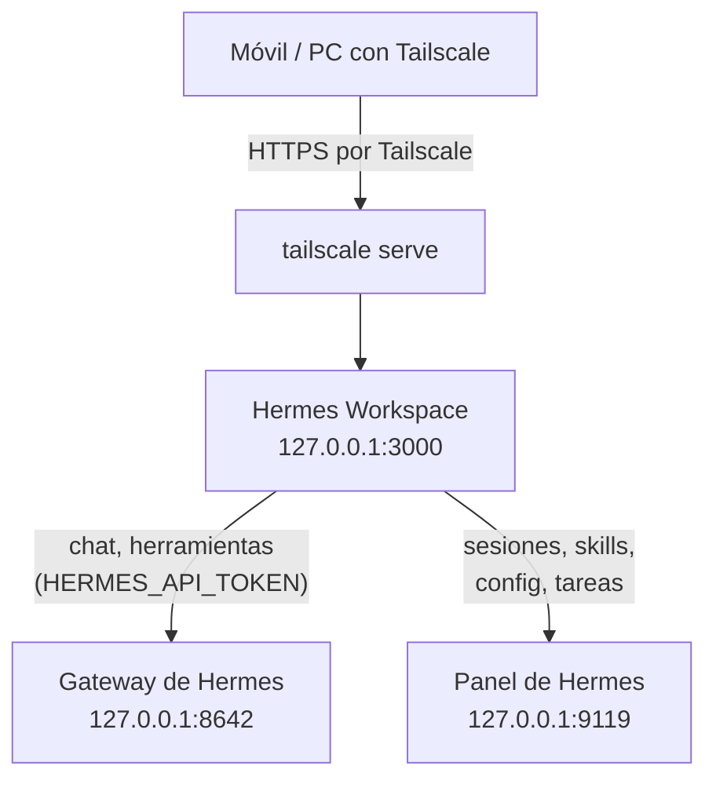

# 6. Hermes Workspace

🌐 [English](../en/06-hermes-workspace.md) · **Español**

[← Anterior: Tailscale en el LXC](05-tailscale.md) · [Índice](../../README.es.md) · [Siguiente: Solución de problemas →](07-solucion-de-problemas.md)

Hermes Workspace es una interfaz web para Hermes Agent: chat con visualización de herramientas, explorador de memoria y skills, tareas programadas, servidores MCP, archivos, terminal y panel de costos. Se instala como app (PWA) en el móvil y el PC. Workspace es solo la interfaz; **Hermes sigue siendo el que hace todo el trabajo**.

## Cómo encajan las piezas



Los tres servicios escuchan solo en `127.0.0.1`: nadie de la red local puede alcanzarlos directamente. Tailscale publica únicamente la interfaz, con HTTPS, para los dispositivos de tu red privada.

Todo se hace en la consola xterm.js del contenedor, como `hermes`.

## 6.1 Comprobar recursos

Compilar Workspace consume bastante memoria: el contenedor necesita al menos **4 GB de RAM** y **1 GB de swap** (Proxmox → contenedor → **Resources**).

```bash
df -h /
```

En **Avail** debe haber al menos 5 GB libres.

## 6.2 Actualizar Hermes

Workspace necesita las APIs recientes de Hermes; con una versión antigua solo funciona el chat básico.

```bash
hermes update
```

## 6.3 Activar el API de Hermes

Genera una clave secreta y guárdala en un lugar seguro:

```bash
openssl rand -hex 32
```

```bash
nano ~/.hermes/.env
```

Asegúrate de que existan estas líneas **una sola vez** (si ya existen, modifícalas en lugar de duplicarlas):

```
API_SERVER_ENABLED=true
API_SERVER_HOST=127.0.0.1
API_SERVER_PORT=8642
API_SERVER_KEY=<clave-generada>
```

| Variable | Función |
| --- | --- |
| `API_SERVER_ENABLED` | Activa el API compatible con OpenAI en el puerto 8642 |
| `API_SERVER_HOST=127.0.0.1` | Solo accesible desde el propio contenedor |
| `API_SERVER_PORT` | Puerto del API (8642 es el valor por defecto) |
| `API_SERVER_KEY` | Clave que exige el API. Da control total sobre Hermes, incluida la terminal |

No borres el resto del archivo (API key de OpenRouter, `OBSIDIAN_VAULT_PATH`, Telegram). Plantilla: [`config/hermes.env.example`](../../config/hermes.env.example).

> En esta instalación, estas líneas ya existían con `API_SERVER_HOST=0.0.0.0`, de una prueba anterior con otra interfaz (Odysseus) que corría en Docker. Con Workspace en el mismo contenedor, `127.0.0.1` es suficiente y más seguro. Además, la clave se había compartido en un chat, así que se sustituyó (ver [E19](07-solucion-de-problemas.md#e19-api_server_host0000-y-clave-compartida)).

## 6.4 Gateway como servicio

```bash
hermes gateway install
```

Si ya estaba instalado, reinícialo para que lea los cambios. Busca el nombre del servicio:

```bash
systemctl --user list-units | grep -i hermes
```

Y reinícialo con ese nombre (por ejemplo, si se llama `hermes-gateway.service`):

```bash
systemctl --user restart hermes-gateway.service
```

Reiniciar el contenedor desde Proxmox también funciona. Comprueba:

```bash
curl http://127.0.0.1:8642/health
```

Debe devolver un estado `"ok"`.

## 6.5 Panel de Hermes como servicio

Workspace usa el panel de Hermes (puerto 9119) para sesiones, skills, configuración y tareas. Sin él, solo funciona el chat.

```bash
which hermes
```

Anota la ruta (por ejemplo, `/home/hermes/.local/bin/hermes`) y crea el servicio:

```bash
nano ~/.config/systemd/user/hermes-dashboard.service
```

```
[Unit]
Description=Panel de Hermes

[Service]
ExecStart=/home/hermes/.local/bin/hermes dashboard
Restart=on-failure

[Install]
WantedBy=default.target
```

Cambia la ruta de `ExecStart` por la que dio `which`. Plantilla: [`systemd/hermes-dashboard.service`](../../systemd/hermes-dashboard.service).

```bash
systemctl --user daemon-reload
```

```bash
systemctl --user enable --now hermes-dashboard.service
```

Comprueba:

```bash
curl http://127.0.0.1:9119/api/status
```

Respuesta resumida de una instalación funcionando:

```json
{
  "gateway_running": true,
  "gateway_platforms": {
    "api_server": { "state": "connected", "listener_base": "http://127.0.0.1:8642" },
    "telegram": { "state": "connected" }
  },
  "components": {
    "gateway": { "status": "ok" },
    "dashboard": { "status": "ok" },
    "storage": { "status": "ok" }
  },
  "overall": "ok"
}
```

Qué confirmar:

- `"overall":"ok"`: todo funciona.
- `"listener_base":"http://127.0.0.1:8642"`: el API escucha solo en el contenedor.
- `"auth_required":false` (en la respuesta completa) es normal: el panel no pide contraseña porque solo escucha en `127.0.0.1`; desde fuera se entra a través de Workspace, que sí está protegido.

No hace falta copiar ningún token del panel: Workspace lo obtiene automáticamente.

## 6.6 Instalar Node.js 22 y pnpm

```bash
curl -fsSL https://deb.nodesource.com/setup_22.x | sudo -E bash -
```

```bash
sudo apt install -y nodejs
```

```bash
sudo corepack enable
```

```bash
node -v
```

```bash
pnpm -v
```

`node -v` debe empezar por `v22`. Si `pnpm -v` pregunta si descargar pnpm, responde `Y`.

## 6.7 Descargar Workspace

```bash
cd ~
```

```bash
git clone https://github.com/outsourc-e/hermes-workspace.git
```

```bash
cd hermes-workspace
```

```bash
pnpm install
```

## 6.8 Configurar Workspace

Genera una contraseña para entrar a la interfaz. **No es la contraseña del usuario `hermes`**: debe ser distinta, porque la de `hermes` da permisos de administrador en el contenedor.

```bash
openssl rand -hex 24
```

Se usa `-hex` en lugar de `-base64` porque este último puede incluir símbolos (`=`, `+`, `/`) que a veces dan problemas en archivos `.env`.

```bash
cp .env.example .env
```

**Desactivar HermesWorld.** Es una función multijugador que, por defecto, conecta con un servidor público externo. Este comando comenta sus líneas sin abrir el editor:

```bash
sed -i 's/^VITE_PLAYGROUND/# VITE_PLAYGROUND/' .env
```

```bash
grep VITE_PLAYGROUND .env
```

Las dos líneas deben empezar por `# VITE_PLAYGROUND`.

> Buscar esas líneas con **Ctrl+W** dentro de nano cierra la pestaña del navegador (ver [E4](07-solucion-de-problemas.md#e4-ctrlw-cierra-la-consola-de-proxmox)). En nano, la búsqueda equivalente es **F6**.

**Añadir la conexión con Hermes:**

```bash
nano .env
```

Ve al final del archivo (**Alt+/**) y añade:

```
HERMES_API_URL=http://127.0.0.1:8642
HERMES_DASHBOARD_URL=http://127.0.0.1:9119
HERMES_API_TOKEN=<mismo-valor-que-API_SERVER_KEY>
HERMES_PASSWORD=<contraseña-de-la-interfaz>
TRUST_PROXY=1
VITE_HERMESWORLD_ENABLED=0
```

| Variable | Función |
| --- | --- |
| `HERMES_API_URL` | Dirección del gateway |
| `HERMES_DASHBOARD_URL` | Dirección del panel |
| `HERMES_API_TOKEN` | **Idéntica** a `API_SERVER_KEY`; si no, todo da "Authentication error" |
| `HERMES_PASSWORD` | Contraseña para entrar a la interfaz |
| `TRUST_PROXY=1` | Necesario porque Tailscale Serve actúa como proxy delante de Workspace |
| `VITE_HERMESWORLD_ENABLED=0` | Oculta la función multijugador |

Plantilla: [`config/workspace.env.example`](../../config/workspace.env.example).

Para evitar errores al copiar la clave a mano, se puede copiar automáticamente desde la configuración de Hermes, sin mostrarla en pantalla:

```bash
key=$(grep '^API_SERVER_KEY=' ~/.hermes/.env | cut -d= -f2-); sed -i "s|^HERMES_API_TOKEN=.*|HERMES_API_TOKEN=$key|" ~/hermes-workspace/.env
```

Y comprobar que coinciden:

```bash
a=$(grep '^API_SERVER_KEY=' ~/.hermes/.env | cut -d= -f2-); b=$(grep '^HERMES_API_TOKEN=' ~/hermes-workspace/.env | cut -d= -f2-); [ "$a" = "$b" ] && echo IGUALES || echo DISTINTAS
```

Debe responder `IGUALES`.

## 6.9 Compilar

```bash
pnpm build
```

Tarda varios minutos. Si se detiene con `Killed` o `JavaScript heap out of memory`, falta memoria: aumenta RAM o swap y repite. Las opciones `VITE_*` se aplican al compilar; si se cambian, hay que repetir `pnpm build`.

## 6.10 Instalar Workspace como servicio

```bash
chmod +x scripts/install-dashboard-service.sh
```

```bash
scripts/install-dashboard-service.sh
```

El script crea el servicio de usuario `hermes-workspace`, que escucha en `127.0.0.1:3000` en modo producción.

## 6.11 Hacer que el servicio lea el .env

**Este paso es imprescindible.** Sin él, el servicio puede arrancar sin leer el `.env`: la interfaz no pide contraseña y el chat falla con "Authentication error" (ver [E22](07-solucion-de-problemas.md#e22-workspace-no-pide-iniciar-sesión) y [E23](07-solucion-de-problemas.md#e23-authentication-error-en-el-chat)).

```bash
export EDITOR=nano
```

```bash
systemctl --user edit hermes-workspace
```

En la zona en blanco indicada (entre los comentarios del principio), escribe:

```
[Service]
EnvironmentFile=/home/hermes/hermes-workspace/.env
```

Guarda y sal. Esto crea `~/.config/systemd/user/hermes-workspace.service.d/override.conf` (plantilla: [`systemd/hermes-workspace.service.d/override.conf`](../../systemd/hermes-workspace.service.d/override.conf)).

```bash
systemctl --user restart hermes-workspace
```

```bash
systemctl --user status hermes-workspace
```

Debe aparecer **active (running)**. Pulsa **q** para salir.

## 6.12 Publicar con HTTPS por Tailscale

Con MagicDNS y HTTPS Certificates activados ([parte 5](05-tailscale.md#55-activar-https)):

```bash
sudo tailscale serve --bg 3000
```

```bash
tailscale serve status
```

Muestra la dirección, del tipo `https://hermesagent.<tu-tailnet>.ts.net`. Solo funciona desde dispositivos de tu red de Tailscale y se mantiene tras reiniciar.

## 6.13 Primer inicio

1. Abre la dirección HTTPS en una **ventana de incógnito** (descarta sesiones guardadas).
2. Debe pedir la contraseña: usa `HERMES_PASSWORD`.
3. Completa la configuración inicial. Workspace detecta el gateway y el panel y activa todas las pantallas.
4. Prueba en el chat: "Lista las notas de mi vault de Obsidian".

> Si en la configuración inicial se escribe un token en **Settings → Connection**, ese valor tiene prioridad sobre el `.env`. Debe ser igual a `API_SERVER_KEY`, o dejarse vacío.

Si aparece un aviso de actualizaciones disponibles, conviene no actualizar desde la interfaz hasta que todo funcione, y hacerlo después desde la terminal ([mantenimiento](09-mantenimiento.md)).

## 6.14 Instalar como app en el móvil

Hermes Workspace es una PWA: se instala desde el navegador y se abre a pantalla completa con su propio icono. Requiere HTTPS, por eso se usa `tailscale serve`.

| Dispositivo | Pasos |
| --- | --- |
| iPhone (Safari) | Abrir la dirección → **Compartir** → **Añadir a pantalla de inicio** → **Añadir** |
| Android (Chrome) | Abrir la dirección → menú **⋮** → **Instalar aplicación** |
| PC (Chrome o Edge) | Icono de instalar en la barra de direcciones → **Instalar** |

Para recibir avisos cuando terminan las tareas programadas, Telegram es el complemento ideal: la PWA es para trabajar con Hermes y Telegram para las notificaciones.

## 6.15 Prueba de reinicio

Reinicia el contenedor desde Proxmox (**Reboot**), espera un par de minutos y abre la dirección HTTPS. Si funciona sin ejecutar nada a mano, la instalación está completa.

## Comprobación

- El navegador pide la contraseña en una ventana de incógnito.
- Hermes responde en el chat usando sus herramientas.
- Sesiones, memoria y skills se muestran (no dicen "Not Available").
- Todo vuelve a funcionar solo después de reiniciar el contenedor.

[← Anterior: Tailscale en el LXC](05-tailscale.md) · [Índice](../../README.es.md) · [Siguiente: Solución de problemas →](07-solucion-de-problemas.md)
